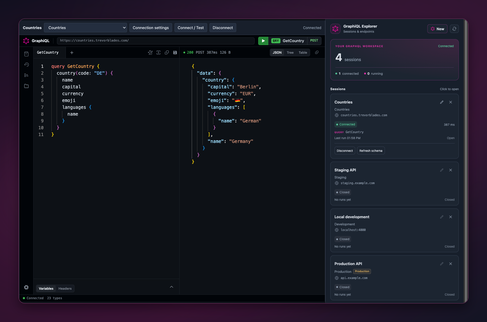

# GraphiQL for Orca

Your GraphQL workspace, inside Orca.

Bring [GraphiQL](https://github.com/graphql/graphiql) into [Orca](https://onorca.dev)'s central editor, with saved sessions, named environments, secure authentication, and a **GraphiQL Explorer** sidebar.

[](https://onorca.dev) [](https://github.com/graphql/graphiql) [](COMPATIBILITY.md) [](LICENSE)


## Install

Requires **Orca desktop 1.4.248 or newer**.

1. Open **Settings → Plugins**.
2. Choose **Add plugin → From a Git URL…** and enter:

   ```text
   https://github.com/faisalmuhammad/orca-graphiql#v0.1.8
   ```

   Keep `#v0.1.8` at the end. Orca requires a release tag or commit hash to install from Git.
3. Review and approve the requested access: a trusted worker with your user account's host access, plugin-owned storage/secrets, and workspace access for session management.
4. Choose **New GraphiQL Session** from Orca's new-file menu, or **New** in **GraphiQL Explorer**, to open a session in the central editor.

The repository includes bundled editor assets, Monaco workers, the icon font, and networking code. Text uses system fonts. Installation requires no Node.js or development dependencies.

## Preview


Previews are **actual Orca editor and panel captures**, presented with rounded corners on a GraphQL magenta gradient. The cover places a large Countries editor capture on the left, with the official GraphQL mark and a glowing plugin title on the right. All previews use the dark theme.

## Create and use a session

1. Choose **New GraphiQL Session** from Orca's new-file menu, or **New** in GraphiQL Explorer. Explorer creates a `.graphiql` file in your chosen local workspace and opens it in the central editor.
2. Open **Connection settings**, name an environment, and set its GraphQL HTTP endpoint. The default session has an empty endpoint and query.
3. Configure authentication if needed, then choose **Connect / Test**. Opening a file never connects or executes automatically. Remote HTTP requires explicit confirmation; localhost HTTP is allowed for development.
4. Write an operation and choose GraphiQL's green Execute control. Use the native **Variables** and **Headers** tabs for inputs. Documentation, autocomplete, validation, formatting, and history come from GraphiQL.
5. Save operations through GraphiQL **Collections** and persist the session with Orca's normal **Save**. Select another environment from the toolbar and connect it before executing.

Collections save query text; variables and headers are excluded from collection items. Local query history can contain query text and variables when enabled.

Use **Add environment…** in the environment selector to configure another endpoint.

`.graphiql` and `.graphiql.json` contain versioned session JSON. Use `.graphql` for plain GraphQL source. Orca's normal source editor remains available through its editor selection.

### Countries example

Copy [templates/countries.graphiql](templates/countries.graphiql) into your workspace and open it. This separate example uses [Trevor Blades' Countries API](https://countries.trevorblades.com/) and includes:

```graphql
query GetCountry {
  country(code: "DE") {
    name
    capital
    currency
    emoji
    languages { name }
  }
}
```

Choose **Connect / Test**, then Execute. Expect **Germany**, **Berlin**, **EUR**, 🇩🇪, and **German**. The example is excluded from the new-file menu.

## Features

| Feature | Behavior |
| --- | --- |
| Official GraphiQL 6 | Native editors, schema browser, variables, headers, history, and Collections |
| Named environments | Endpoint, auth reference, non-sensitive headers, timeout, and production designation |
| Authentication | Bearer token, API key, or secret headers; secure storage or explicitly temporary credentials |
| GraphiQL Explorer | Open saved session files; New, Refresh, rename display name, and confirmed removal |
| Request controls | Cancellation, timeout, bounded concurrency, duplicate and stale-response protection |
| Native documents | Save, read-only handling, external changes, and conflict/reload workflow |
| Host integration | Light/dark theme, local Monaco workers, multiple tabs, and resizable layouts |

Explorer has a theme-aware GraphQL overview showing session, connection, and running-request counts. Compact session cards show the environment, endpoint host, status, production/read-only designation, and recent operation timing. Rename requires an open writable editor; use Orca Save afterward. **Remove keeps the file** and asks for confirmation. Rename or delete the actual file through Orca's file explorer.

<details>
<summary>More dark previews</summary>




The Explorer preview combines native editor and panel captures, showing a live Countries result with Local development, Staging, and Production sample sessions. The sample endpoints are disconnected; Staging and Production URLs are illustrative.

</details>

### Authentication and production

The trusted worker resolves and adds credentials. Credentials entered through authentication settings are stored in Orca secrets or kept temporarily in memory; session files contain only saved credential references. Saved credentials are bound to the exact session, environment, and endpoint. If Orca cannot protect secrets, choose temporary credentials; there is no plaintext fallback. Native Headers are temporary and excluded from saved history and Collections. Keep secrets out of saved query text, variables, and non-sensitive environment headers.

Mark an environment **Production** to require mutation confirmation. This identifies GraphQL mutations; queries can still have server-side effects. Redirects are refused, so configure the final endpoint URL.

## Troubleshooting

| Symptom | What to check |
| --- | --- |
| Blank editor with `React is not defined` on 0.1.6 or 0.1.7 | Update to 0.1.8 and reopen the session. The release includes the corrected compiled editor. |
| Disconnected after opening, switching, or reloading | Choose Connect / Test. Approval is temporary and expires after inactivity. |
| Authentication failed | Check auth type, header name, credential, and exact endpoint binding. |
| Schema unavailable | Introspection may be disabled. A reachable endpoint can execute without autocomplete. |
| Explorer cannot open a session | Open its local workspace. If the file moved, open/save it again, then Refresh. |
| Missing Explorer session | Open/save once to register its identifier. Duplicate copied identifiers are ambiguous. |
| Edit conflict | Reload the external version or resolve it in the source editor before saving. |
| Oversized response | Reduce fields or paginate. Responses are rejected whole, never truncated. |
| TLS/network error | Check endpoint, certificates, and connectivity. TLS validation remains enabled. |
| Endpoint URL rejected | Use HTTP(S) without URL credentials, query parameters, or fragments. Configure authentication through Connection settings. |

Limits: **60 KiB complete worker-request inputs**, **768 KiB responses/documents**, **512 KiB local editor state per session/environment/endpoint**, **50 history entries**, **8 concurrent worker requests**, **2 per editor**. Execution timeouts are configurable from **1–90 seconds**. Request sizing includes JSON encoding, variables, extensions, headers, and connection settings; the 60 KiB budget leaves room below Orca's 64 KiB bridge cap.

Subscriptions, multipart responses, `@defer`/`@stream`, and chunked large responses are follow-up work. Windows/Linux remain untested; see [validation and limitations](COMPATIBILITY.md). Orca accepts only built-in sidebar activity icons, so the rail uses `code`; the panel, editor, plugin, and new-file action use the official GraphQL logo.

<details>
<summary>Local development and validation</summary>

The plugin root contains Orca's manifest, compiled runtime assets, templates, and previews. Source, dependencies, tests, build scripts, and original captures live under `build/`.

Requires Node.js 22+ and npm. From the repository root:

```sh
npm --prefix build ci
npm --prefix build run build
npm --prefix build run typecheck
npm --prefix build test
npm --prefix build run test:bundle
orca plugin test build --json
orca plugin validate . --json
orca plugin check . --json
```

Add the repository root through **Settings → Plugins → Development folders…**. Release tags must include compiled `editor/`, `worker/`, and `activity/`; Orca loads them directly. Exclude `node_modules/`, `.orca/`, `build/.cache/`, and `dist/` from uploads and Git.

For manual source uploads, include `build/` without its dependencies/cache and include the compiled runtime folders. When a build changes editor assets, replace the entire `editor/` folder to remove obsolete hashes. Release 0.1.8 includes rebuilt editor assets for the tab-rendering fix; existing previews, worker, sidebar, and templates can stay as they are. Remove the old `build/src/editor/stubs/framer-motion.jsx` adapter, which is replaced by `framer-motion.js`. Stage additions and removals with `git add .`, then run `npm --prefix build run release:check` before tagging. The checker also rejects the known broken tab adapter from 0.1.6/0.1.7, including unused copies left in `editor/assets/`.

See [build instructions, compatibility adaptations, and test commands](build/README.md) and [bundle measurements](BUNDLE_SIZE.md).

</details>

## Attribution and license

An unofficial integration of [GraphiQL](https://github.com/graphql/graphiql), maintained by [faisalmuhammad](https://github.com/faisalmuhammad). GraphiQL/GraphQL credit the GraphQL Foundation and their contributors. The logo comes from official GraphiQL assets. The example credits **Trevor Blades**; its server code is not bundled.

| Source | License | Included notice |
| --- | --- | --- |
| GraphiQL, toolkit, React integration, Collections | MIT | [LICENSE-GRAPHIQL](LICENSE-GRAPHIQL) |
| GraphQL.js | MIT | [LICENSE-GRAPHQL](LICENSE-GRAPHQL) |
| React and React DOM | MIT | [Third-party notices](THIRD_PARTY_NOTICES.txt) |
| Monaco Editor | MIT | [LICENSE-MONACO](LICENSE-MONACO) |
| Fira Code (original screenshots) | SIL OFL 1.1 | [LICENSE-FIRA-CODE](LICENSE-FIRA-CODE) |
| Roboto (original screenshots) | Apache 2.0 | [LICENSE-ROBOTO](LICENSE-ROBOTO) |

Plugin code uses [MIT](LICENSE). See [credits/provenance](THIRD_PARTY_NOTICES.md) and [complete license texts](THIRD_PARTY_NOTICES.txt), including development tools. Identical legal documents are printed once with a package index; all distinct original copyright and license text remains included.
