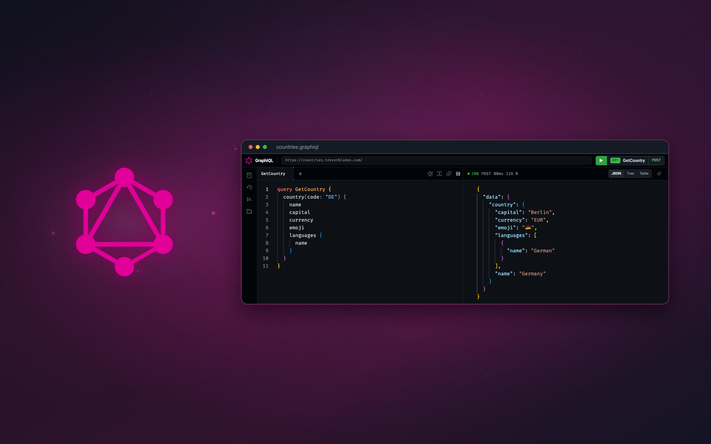
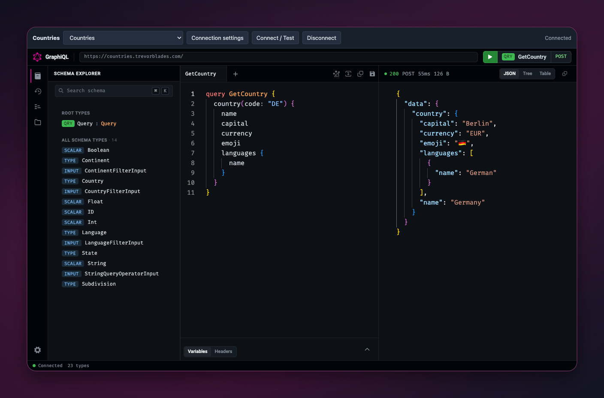
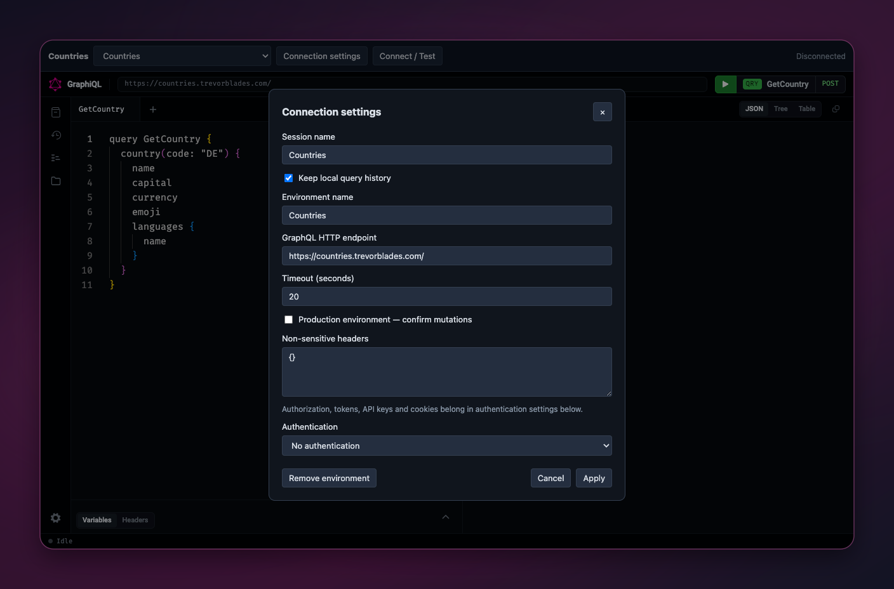
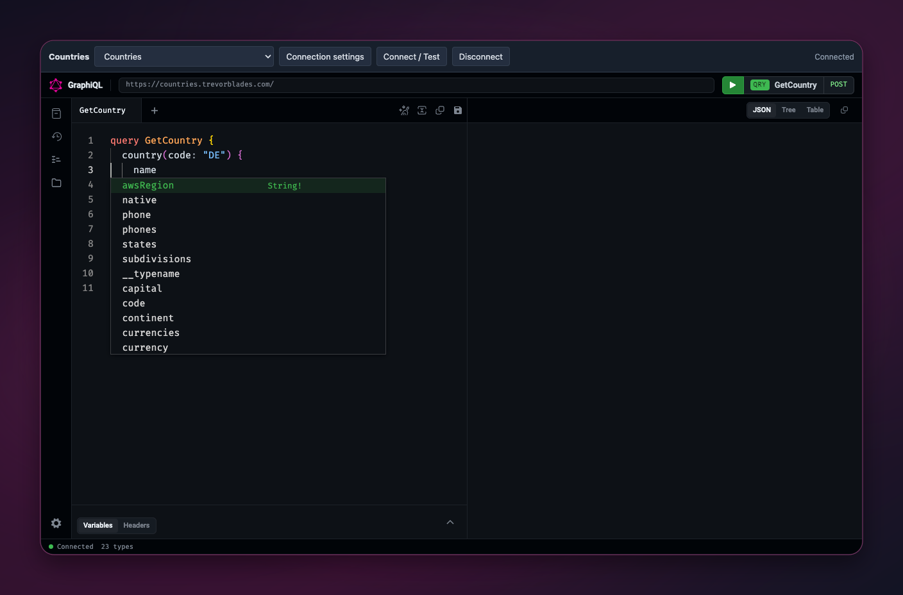

# GraphiQL for Orca

Your GraphQL workspace, inside Orca.

Bring [GraphiQL](https://github.com/graphql/graphiql) into [Orca](https://onorca.dev)'s central editor, with saved sessions, named environments, secure authentication, and a **GraphiQL Explorer** sidebar.

[](https://onorca.dev) [](https://github.com/graphql/graphiql) [](COMPATIBILITY.md) [](LICENSE)



## Install

Requires **Orca desktop 1.4.248 or newer**.

1. Extract the bundled `graphiql-0.1.0.zip` into a permanent local folder.
2. Open **Settings → Plugins → Development folders…** and add the extracted folder containing `orca-plugin.json`.
3. Review and approve the requested access: a trusted networking worker, plugin-owned storage/secrets, and local workspace session-file access.

The bundled folder includes all editor assets, Monaco workers, fonts, and networking code. Installation requires no Node.js or development dependencies.

## Preview



Editor previews are **actual Orca custom-editor captures**, presented with rounded corners on a GraphQL magenta gradient. The cover combines the official GraphQL mark with a framed Countries editor capture, composed for Orca's cropped plugin banner. All previews use the dark theme.

## Create and use a session

1. Choose **New GraphiQL Session** from Orca's new-file menu, or **New** in GraphiQL Explorer. Explorer creates a `.graphiql` file in your chosen local workspace and opens it in the central editor.
2. Open **Connection settings**, name an environment, and set its GraphQL HTTP endpoint. The default session has an empty endpoint and query.
3. Configure authentication if needed, then choose **Connect / Test**. Opening a file never connects or executes automatically. Remote HTTP requires explicit confirmation; localhost HTTP is allowed for development.
4. Write an operation and choose GraphiQL's green Execute control. Use the native **Variables** and **Headers** tabs for inputs. Documentation, autocomplete, validation, formatting, and history come from GraphiQL.
5. Save operations through GraphiQL **Collections** and persist the session with Orca's normal **Save**. Select another environment from the toolbar and connect it before executing.

Use **Add environment…** in the environment selector to configure another endpoint.

`.graphiql` and `.graphiql.json` contain versioned session JSON. Use `.graphql` for plain GraphQL source. Orca's normal source editor remains available through its editor selection.

### Countries example

Copy [templates/countries.graphiql](templates/countries.graphiql) into your workspace and open it. This separate example uses [Trevor Blades' Countries API](https://countries.trevorblades.com/) and includes:

```graphql
query GetCountry {
  country(code: "DE") {
    name
    capital
    currency
    emoji
    languages { name }
  }
}
```

Choose **Connect / Test**, then Execute. Expect **Germany**, **Berlin**, **EUR**, 🇩🇪, and **German**. The example is excluded from the new-file menu.

## Features

| Feature | Behavior |
| --- | --- |
| Official GraphiQL 6 | Native editors, schema browser, variables, headers, history, and Collections |
| Named environments | Endpoint, auth reference, non-sensitive headers, timeout, and production designation |
| Authentication | Bearer token, API key, or secret headers; secure storage or explicitly temporary credentials |
| GraphiQL Explorer | Click to open/focus; New, Refresh, rename display name, and confirmed removal |
| Request controls | Cancellation, timeout, bounded concurrency, duplicate and stale-response protection |
| Native documents | Save, read-only handling, external changes, and conflict/reload workflow |
| Host integration | Light/dark theme, local Monaco workers, multiple tabs, and resizable layouts |

Explorer shows the environment, endpoint host, status, production/read-only designation, and recent operation timing. Rename requires an open writable editor; use Orca Save afterward. **Remove keeps the file** and asks for confirmation. Rename or delete the actual file through Orca's file explorer.

<details>
<summary>More dark editor previews</summary>





</details>

### Authentication and production

The trusted worker resolves and adds credentials. Tokens and API keys never enter session files. Saved credentials are bound to the exact session, environment, and endpoint. If Orca cannot protect secrets, choose temporary credentials; there is no plaintext fallback. Native Headers are temporary and excluded from saved history and Collections. Persist only non-sensitive environment headers.

Mark an environment **Production** to require mutation confirmation. This identifies GraphQL mutations; queries can still have server-side effects. Redirects are refused, so configure the final endpoint URL.

## Troubleshooting

| Symptom | What to check |
| --- | --- |
| Disconnected after opening, switching, or reloading | Choose Connect / Test. Approval is temporary and expires after inactivity. |
| Authentication failed | Check auth type, header name, credential, and exact endpoint binding. |
| Schema unavailable | Introspection may be disabled. A reachable endpoint can execute without autocomplete. |
| Explorer cannot open a session | Open its local workspace. If the file moved, open/save it again, then Refresh. |
| Missing Explorer session | Open/save once to register its identifier. Duplicate copied identifiers are ambiguous. |
| Edit conflict | Reload the external version or resolve it in the source editor before saving. |
| Oversized response | Reduce fields or paginate. Responses are rejected whole, never truncated. |
| TLS/network error | Check endpoint, certificates, and connectivity. TLS validation remains enabled. |

Limits: **256 KiB requests**, **768 KiB responses/documents**, **512 KiB private storage**, **50 history entries**, **8 concurrent worker requests**, **2 per editor**. Execution timeouts are configurable within the session schema's bounds.

Subscriptions, multipart responses, `@defer`/`@stream`, and chunked large responses are follow-up work. Windows/Linux remain untested; see [validation and limitations](COMPATIBILITY.md). Orca accepts only built-in sidebar activity icons, so the rail uses `code`; the panel, editor, plugin, and new-file action use the official GraphQL logo.

<details>
<summary>Local development and validation</summary>

Requires Node.js 22+ and npm.

```sh
npm ci
npm run build
npm run typecheck
npm test
orca plugin test . --json
orca plugin validate . --json
orca plugin check . --json
orca plugin dev watch . --json
```

Orca's test runner supplies its native document host; ordinary Vitest skips those tests. HTTP integration tests require permission to bind localhost.

With the development plugin loaded, `npm run runtime:test` exercises Countries through the actual worker; `npm run runtime:fixture` verifies authentication, redirects, disabled introspection, and production mutations using a local fixture. `npm run package` builds a runtime-only ZIP with size measurements and SHA-256 checksums under `dist/`.

Public host API contracts are defined in `src/shared/orca-api.ts`.

Original screenshots are preserved in `assets/captures/`. `npm run screenshots` rebuilds their gradient framing without resizing the captured interface. `npm run images` rebuilds the active cover. Original captures are excluded from the runtime ZIP.

</details>

## Attribution and license

An unofficial integration of [GraphiQL](https://github.com/graphql/graphiql), maintained by [faisalmuhammad](https://github.com/faisalmuhammad). GraphiQL/GraphQL credit the GraphQL Foundation and their contributors. The logo comes from official GraphiQL assets. The example credits **Trevor Blades**; its server code is not bundled.

| Source | License | Included notice |
| --- | --- | --- |
| GraphiQL, toolkit, React integration, Collections | MIT | [LICENSE-GRAPHIQL](LICENSE-GRAPHIQL) |
| GraphQL.js | MIT | [LICENSE-GRAPHQL](LICENSE-GRAPHQL) |
| React and React DOM | MIT | [Third-party notices](THIRD_PARTY_NOTICES.txt) |
| Monaco Editor | MIT and upstream third-party notices | [LICENSE-MONACO](LICENSE-MONACO) |
| Fira Code | SIL OFL 1.1 | [LICENSE-FIRA-CODE](LICENSE-FIRA-CODE) |
| Roboto | Apache 2.0 | [LICENSE-ROBOTO](LICENSE-ROBOTO) |

Plugin code uses [MIT](LICENSE). See [credits/provenance](THIRD_PARTY_NOTICES.md) and [complete license texts](THIRD_PARTY_NOTICES.txt), including development tools.
